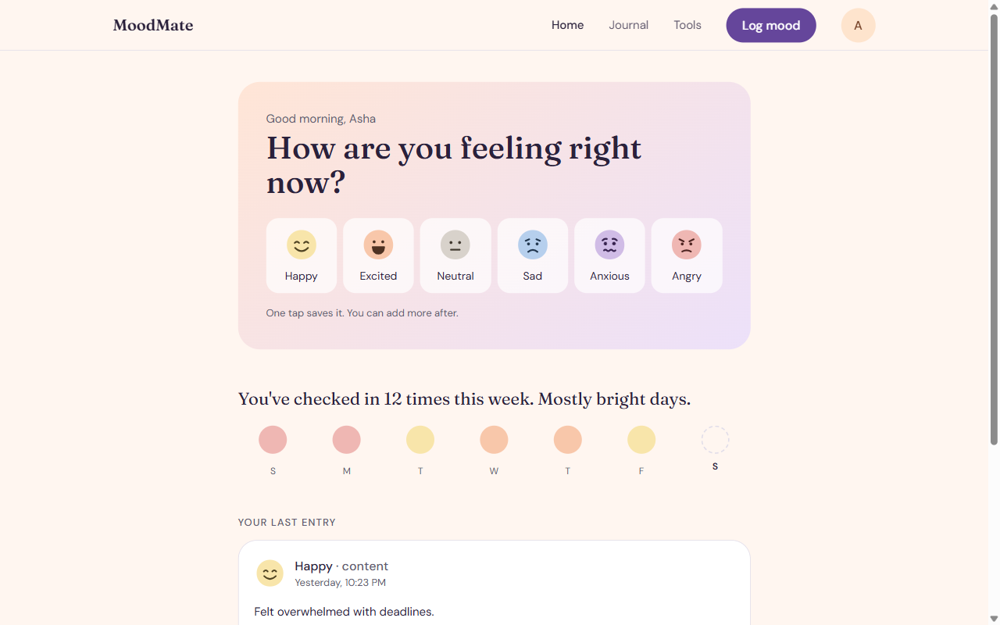
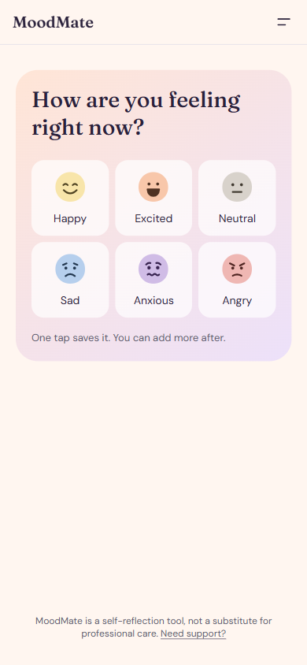
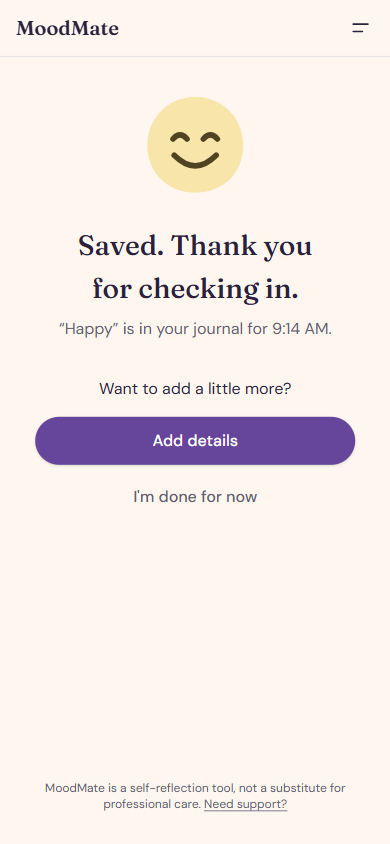
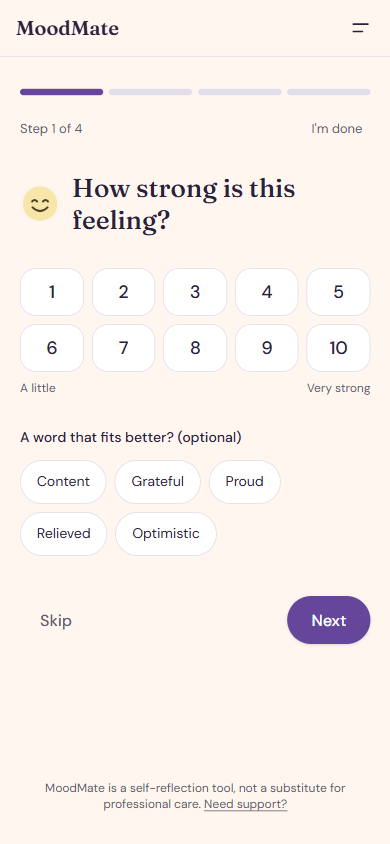
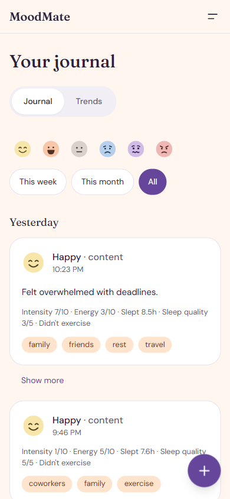
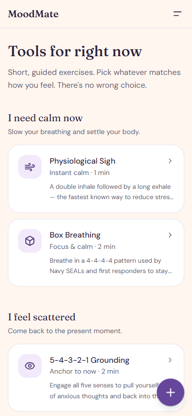
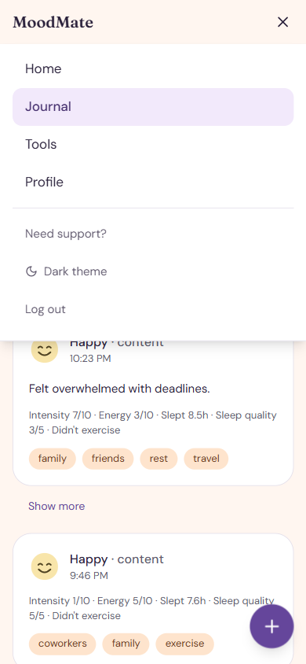
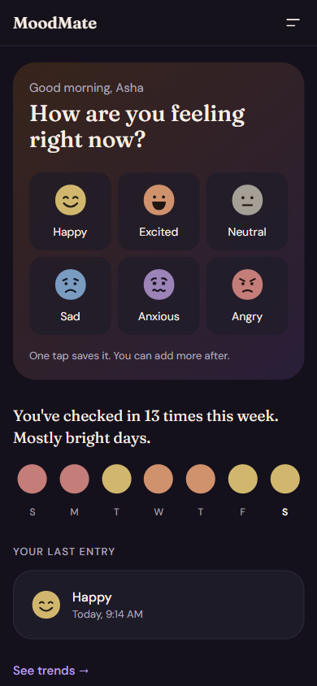
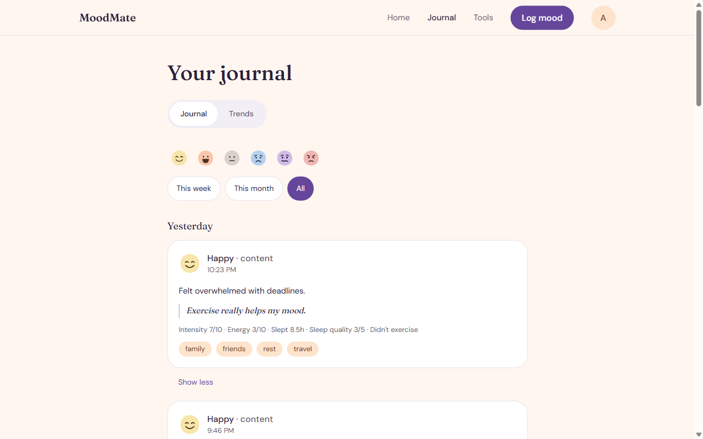
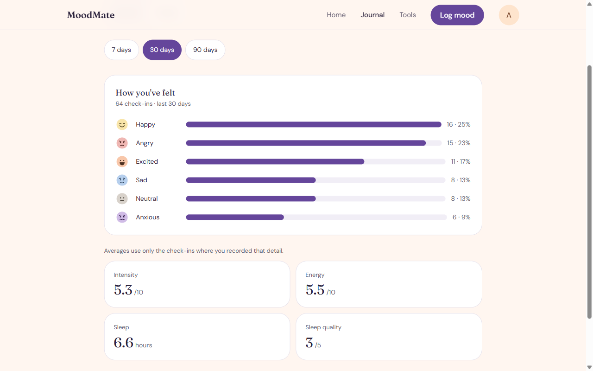

# MoodMate

A calm, mobile-first mood journal: log how you feel in one tap, add detail only if you want to, and see your week at a glance. Built with React, Express, TypeScript and MongoDB.

## Screenshots

<p align="center">
  
  <br>
  <sub>Dashboard: one tap on a face saves the mood. Below it, a sentence about your week, a 7-day strip and your last entry.</sub>
</p>

**Logging on a phone: pick a mood, it's saved, add details if you like**

<table>
  <tr>
    <td align="center" width="33%"></td>
    <td align="center" width="33%"></td>
    <td align="center" width="33%"></td>
  </tr>
  <tr>
    <td align="center"><sub>1. Tap a face</sub></td>
    <td align="center"><sub>2. Saved straight away</sub></td>
    <td align="center"><sub>3. Optional details, one question per screen</sub></td>
  </tr>
</table>

<table>
  <tr>
    <td align="center" width="25%"></td>
    <td align="center" width="25%"></td>
    <td align="center" width="25%"></td>
    <td align="center" width="25%"></td>
  </tr>
  <tr>
    <td align="center"><sub>Journal</sub></td>
    <td align="center"><sub>Tools by how you feel</sub></td>
    <td align="center"><sub>Menu</sub></td>
    <td align="center"><sub>Dark theme</sub></td>
  </tr>
</table>

<table>
  <tr>
    <td align="center" width="50%"></td>
    <td align="center" width="50%"></td>
  </tr>
  <tr>
    <td align="center"><sub>Journal: entries grouped by day, filter by mood and range</sub></td>
    <td align="center"><sub>Trends: mood breakdown and averages over 7, 30 or 90 days</sub></td>
  </tr>
</table>

## Features

- **One-tap logging**: tapping a face saves the entry right away, with only `{ mood }` stored.
- **Optional "Add details"**: four skippable screens, one question each (intensity, energy and sleep, what's going on, notes). Tags are chips with suggestions from your recent entries. Details only fill fields that are still empty; nothing you already saved gets rewritten.
- **Gentle support**: after a low mood you get a soft nudge towards a breathing exercise. A low mood at intensity 7 or higher opens a full support screen with sample helplines. It never blocks you.
- **Dashboard**: a one-sentence summary of your week, a 7-day mood strip and your last entry.
- **Journal**: a diary of entries grouped by day, filtered by mood and by This week / This month / All.
- **Trends**: mood breakdown over 7, 30 or 90 days, plus averages. Averages use only the values you actually recorded, and the screen says "not enough data" instead of showing fake zeros.
- **Tools**: short guided exercises grouped by how you feel. You don't need an account to use them.
- **Design**: "Sunrise" theme in light and dark, Fraunces + DM Sans fonts, custom SVG mood faces, WCAG AA contrast, 44px tap targets and support for reduced motion.
- **Layout**: a hamburger menu and floating log button on mobile, a slim top bar on desktop.
- **Admin user management**: search and filters, change roles, toggle Pro, soft delete, with protection so you can't demote yourself, delete yourself or remove the last admin.
- **Weekly AI analysis**: every Sunday a cron job sends Pro users an email with a Gemini-written review of their week (needs at least 3 logs).
- **Auth**: JWT with `user`, `therapist` and `admin` roles. Login and register are rate-limited.
- **Data-driven routing**: routes and their allowed roles live in JSON, and every page is lazy-loaded.
- **API docs**: Swagger UI at `/api-docs` outside production.

## Tech Stack

| Layer | Technologies |
|-------|-------------|
| **Frontend** | React 18, TypeScript, Vite 6, Tailwind CSS 3, shadcn/ui (Radix), React Router 6, React Hook Form, Zod, Axios, Framer Motion, lucide-react, react-toastify, @fontsource-variable (Fraunces, DM Sans) |
| **Backend** | Node.js 24, Express 4, TypeScript, Mongoose 8, MongoDB, JWT (jose), bcryptjs, Zod, Pino, helmet, express-rate-limit, node-cron, Nodemailer, Google Gemini (`@google/genai`), Swagger |
| **Testing** | Server: Jest, Supertest, mongodb-memory-server. Client: Vitest, React Testing Library, jsdom |
| **Code Quality** | ESLint, Prettier, Husky, lint-staged |
| **Infrastructure** | Docker, nginx, GitHub Actions CI/CD, AWS (ECR, EC2, S3, CloudFront) |

## Project Structure

```
moodmate/
├── client/                  # React frontend (Vite)
│   ├── src/
│   │   ├── api/             # Axios instance with interceptors
│   │   ├── auth/            # ProtectedRoute, role rules (access.ts)
│   │   ├── components/      # ui/ (shadcn), layout/, mood/ (faces, pickers, chips), support/
│   │   ├── context/         # AuthContext, ThemeContext
│   │   ├── lib/             # Mood catalogue, support rules, week summary, details patch
│   │   ├── pages/           # Home, auth, dashboard, mood tracking + journal, tools, profile, admin
│   │   ├── routes/          # Data-driven routing (JSON config + lazy loading)
│   │   ├── services/        # API call wrappers
│   │   └── types/           # TypeScript interfaces
│   ├── Dockerfile           # Multi-stage: Node build → nginx serve
│   └── nginx.conf           # SPA fallback + API proxy
│
├── server/                  # Express backend
│   ├── src/
│   │   ├── config/          # Env validation, DB connection, JWT, Swagger
│   │   ├── controllers/     # Thin request handlers
│   │   ├── services/        # Business logic, AI provider, email
│   │   ├── repositories/    # Data access (generic BaseRepository + extensions)
│   │   ├── models/          # Mongoose schemas (User, MoodLog)
│   │   ├── jobs/            # node-cron jobs (weekly analysis email)
│   │   ├── templates/       # Email templates
│   │   ├── middlewares/     # Auth, admin guard, errors, rate limiting, request ID
│   │   ├── validations/     # Zod schemas
│   │   ├── utils/           # Logger, custom errors, async handler
│   │   ├── seeds/           # Development data seeder
│   │   └── __tests__/       # Integration + unit tests
│   └── Dockerfile           # Multi-stage: TS compile → Node alpine runtime
│
├── docker-compose.yml       # Local stack built from source (no MongoDB service)
├── docker-compose.prod.yml  # Production backend (pre-built image from ECR)
└── .github/workflows/       # CI (lint + test + build) + CD (ECR/EC2 + S3/CloudFront)
```

## Getting Started

### Prerequisites

- Node.js 24+
- A MongoDB instance (local install or MongoDB Atlas)

### Local Development

1. **Clone the repository**
   ```bash
   git clone https://github.com/Nidhin-mohan/moodmate.git
   cd moodmate
   ```

2. **Set up the server**
   ```bash
   cd server
   cp .env.example .env    # Fill in the variables listed below
   npm install
   npm run dev              # Runs at http://localhost:5000
   ```

3. **Set up the client** (in a new terminal)
   ```bash
   cd client
   cp .env.example .env    # Default API URL is http://localhost:5000/api/v1
   npm install
   npm run dev              # Runs at http://localhost:5173
   ```

### Docker (Full Stack)

There is **no MongoDB service** in `docker-compose.yml`, so `MONGO_URI` must point at a MongoDB you run yourself (Atlas, or one on the host).

```bash
docker-compose up --build
```

- Compose fills `MONGO_URI`, `JWT_SECRET` and `CORS_ORIGINS` from your shell or a root-level `.env` file.
- The server also requires `GEMINI_API_KEY` and the `SMTP_*` variables at startup. Add them to the backend's `environment` in `docker-compose.yml`, or the container will exit on env validation.
- Frontend: `http://localhost:3000` (nginx, proxies `/api/` to the backend)
- Backend: `http://localhost:5000`

## Environment Variables

### Server (`server/.env`)

All variables are validated with Zod at startup (`server/src/config/env.ts`). If one is missing or invalid, the server prints the failing field and exits.

| Variable | Required | Description |
|----------|----------|-------------|
| `PORT` | No (default `5000`) | HTTP port |
| `MONGO_URI` | Yes | MongoDB connection string |
| `JWT_SECRET` | Yes | JWT signing secret, at least 16 characters |
| `NODE_ENV` | No (default `development`) | `development`, `production` or `test` |
| `CORS_ORIGINS` | No (default `http://localhost:5173`) | Allowed origins, comma-separated |
| `GEMINI_API_KEY` | Yes | Google Gemini API key for the weekly analysis |
| `SMTP_HOST` | Yes | SMTP server for outgoing email |
| `SMTP_PORT` | No (default `587`) | SMTP port |
| `SMTP_USER` | Yes | SMTP username |
| `SMTP_PASS` | Yes | SMTP password or app password |
| `SMTP_FROM` | No | "From" address on outgoing email |

### Client (`client/.env`)

| Variable | Description |
|----------|-------------|
| `VITE_API_BASE_URL` | Backend API base URL, e.g. `http://localhost:5000/api/v1`. Falls back to `/api/v1` (the nginx proxy) when unset. |

> **Note:** Vite env vars are baked into the bundle at build time. Changing `VITE_API_BASE_URL` requires a rebuild.

## API Endpoints

Base path: `/api/v1/`. Query strings are validated with Zod, so bad input returns a 400 with field-level errors.

| Method | Path | Auth | Description |
|--------|------|------|-------------|
| GET | `/health` | No (10 req/min) | Health check: `{ success, status, db, uptime }`, 200 or 503 |
| POST | `/api/v1/auth/register` | No (20 req/15 min) | Register |
| POST | `/api/v1/auth/login` | No (20 req/15 min) | Login, returns JWT |
| GET | `/api/v1/auth/profile` | JWT | Get own profile |
| POST | `/api/v1/mood` | JWT | Create a mood log (only `mood` is required; `date` at most one day in the future) |
| GET | `/api/v1/mood` | JWT | List logs: `page` ≥ 1, `limit` 1–100, `startDate`/`endDate` (ISO), `mood` (exact match, case-insensitive) |
| GET | `/api/v1/mood/stats` | JWT | Aggregated stats over `days` (1–365, default 30); averages are `null` when nothing was recorded |
| GET | `/api/v1/mood/:id` | JWT | Get a single log |
| PUT | `/api/v1/mood/:id` | JWT | Update a log |
| DELETE | `/api/v1/mood/:id` | JWT | Delete a log |
| GET | `/api/v1/admin/users` | JWT + admin | List users: `page`, `limit`, `search` (literal, ≤ 100 chars), `role`, `isPro`, `proSinceFrom`/`proSinceTo`, `includeDeleted` |
| PATCH | `/api/v1/admin/users/:id` | JWT + admin | Update `role` / `isPro` / `name` (not your own role) |
| DELETE | `/api/v1/admin/users/:id` | JWT + admin | Soft-delete (not yourself, not the last admin) |

Non-admins get a **403** on admin routes. Swagger docs are at `GET /api-docs` outside production.

## Architecture

### Backend: layered pattern

```
Routes → Controllers → Services → Repositories → MongoDB
```

- **Controllers**: parse the request, validate body and query with Zod, then call a service
- **Services**: business logic. Every mood query is scoped to `{ user: userId }`
- **Repositories**: a generic `BaseRepository<T>` provides CRUD, and `UserRepository` and `MoodLogRepository` add collection-specific queries. Services never import Mongoose models
- **Errors**: custom classes (`BadRequestError`, `UnauthorizedError`, `ForbiddenError`, `NotFoundError`, `ConflictError`) handled by one central middleware. Every error response carries a `requestId`
- **Soft delete**: deleted users can't log in, their tokens stop working and the weekly email skips them

### Frontend: data-driven routing

Routes are declared in `routes.json`, mapped to lazy-loaded components in `componentMap.ts`, and guarded by role (`public`, `user`, `therapist`, `admin`). Therapists and admins get every `user` route. Adding a page takes one entry in each file.

### CI/CD pipeline

- **CI**: on push or PR to `main`, lints, tests and builds the client and the server (Node 24)
- **CD Backend**: on push to `main` with server changes, builds the Docker image, pushes it to AWS ECR and deploys it to EC2 with `docker-compose.prod.yml`
- **CD Frontend**: on push to `main` with client changes (or a manual run), builds with Vite, syncs to S3 and invalidates the CloudFront cache

AWS access in both CD workflows uses GitHub OIDC role assumption, not stored keys.

## Scripts

### Server

```bash
npm run dev            # Development server with live reload (tsx watch)
npm run debug          # Same, with the Node inspector
npm run build          # Compile TypeScript to dist/
npm start              # Run the production build
npm test               # Run all tests
npm run test:coverage  # Tests with coverage report (thresholds enforced)
npm run lint           # Check for lint issues
npm run format         # Auto-format with Prettier
npm run seed           # Seed 20 sample users (edit src/seeds/index.ts to also seed mood logs for a user id)
```

### Client

```bash
npm run dev            # Vite dev server with HMR
npm run build          # Type-check + production build
npm run lint           # Check for lint issues
npm run preview        # Preview the production build locally
npm test               # Run Vitest once
npm run test:watch     # Vitest in watch mode
```

## Testing

**Server**: Jest + Supertest against the real Express app, with **mongodb-memory-server**, so you don't need an external database.

```bash
cd server
npm test               # Run all tests
npm run test:coverage  # Coverage (50% branches, 60% functions/lines/statements)
npx jest src/__tests__/auth.test.ts   # Run a single test file
```

- Integration: `auth`, `emailCase`, `mood`, `moodQuery` (query validation, future dates), `admin` (access, filters, self-protection, last admin)
- Job: `weeklyAnalysisJob` (AI and email mocked), `weeklyStats`
- Unit: `validation` (Zod schemas)

**Client**: Vitest + React Testing Library on jsdom. Tests sit next to the code as `*.test.ts(x)` and cover pages, services, routing rules and the `lib/` helpers.

```bash
cd client
npm test
```

Changes to the UI are also checked in a real browser during development with a Playwright-driven `ui-tester` agent.

## License

MIT
